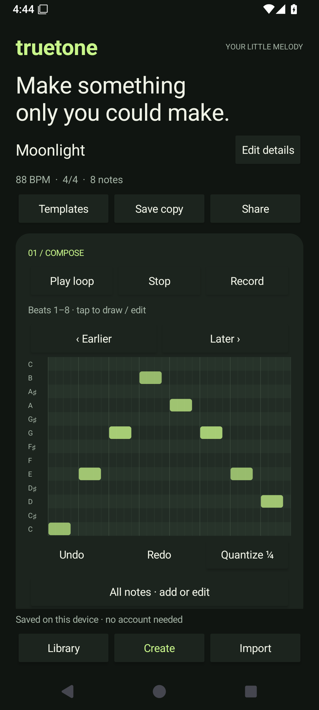
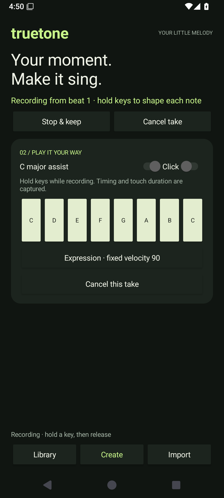
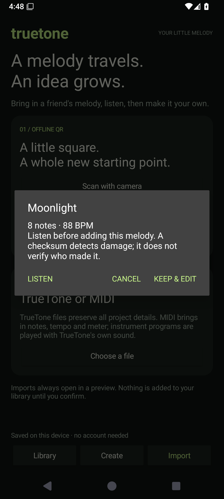

# TrueTone v2 verification — 2026-09-24

## Delivery state

All four implementation stages are represented in the active app. Local core/build/lint/device checks pass. This is an installable debug MVP, **not a completed physical-device or production-release acceptance**.

| Stage | Implemented | Evidence |
| --- | --- | --- |
| 1. Correct musical data | Immutable Project/NoteEvent, 960-PPQ time, per-note velocity/duration/channel, stable overdubs, MIDI import/export | 15 core tests, independent Java MIDI reader, preserved original MIDI fixtures |
| 2. Local creation workflow | Draw/record/edit/listen, undo/redo, atomic drafts, save/reopen, no login | Android create/save/reopen and recorded-duration/cancel tests; process termination check |
| 3. Sharing | Versioned bounded QR, internal scanner, image/text import, preview/confirm, `.ttn`/MIDI/WAV and temporary URI sharing | 7 Android tests; actual system-picker import between two emulators; identical saved bytes; actual MIDI/WAV system exports |
| 4. Experience and maintenance | Library/Create/Import interface, templates, scale assistance, quantization, click, optional calibrated tilt, audio focus/route stop, pinned build and CI | Captured UI, permission rejection flow, local build/lint/device suite; physical checks below remain open |

## Reproduction

JDK: Temurin 17.0.20. Gradle: 9.1.0. AGP: 9.0.0. Compile platform: Android 36.1. Build Tools: 36.0.0. Test device: isolated API 35 / Android 15 ARM64 AOSP emulator, 1080 × 2400 at 420 dpi. A second independent emulator was used as the QR receiver. Audio was disabled at the emulator host output; no acoustic latency claim is made.

With `JAVA_HOME`, `ANDROID_HOME` and optionally `ANDROID_SERIAL` configured:

```sh
./gradlew :core:test :app:assembleDebug :app:lintDebug :app:connectedDebugAndroidTest --console=plain
```

Final run: **BUILD SUCCESSFUL**, 28 seconds. Core: **15 tests, 0 failures/errors**. Android: **7 tests, 0 failures/errors**. Lint: **0 errors**; warnings remain for English text localization, dependency updates and legacy backup metadata. There is also a Gradle deprecation summary. No lint baseline suppresses errors.

Reports generated by the build:

- `core/build/reports/tests/test/index.html`
- `studio/build/reports/androidTests/connected/debug/index.html`
- `studio/build/reports/lint-results-debug.html`

The verification recorded here was performed locally before PR submission. Consult the pull request checks for subsequent GitHub Actions results.

## What the tests establish

Core tests cover project/QR round-trips, multiple tempos, exact note durations and channels, independent MIDI header/length/tempo parsing, empty/single-note/overdub cases, stable ordering, immutable snapshots, undo/redo, multi-track quantization, invalid/truncated input, 1,000 seeded malformed inputs, event/QR/polyphony limits, atomic reopening, damaged-draft preservation, frame-loop repeatability and sample-for-sample WAV/preview-renderer equality.

Device tests exercise save/undo/redo/relaunch, recording a held note, canceling a take, import without premature writes, confirmation/cancel behavior, screenshot QR decoding, the actual dense-QR regression fixture, and provider path/write denial. They use production classes; some setup and transitions are invoked directly through instrumentation. The manual system-picker checks below complement those tests.

One intermediate instrumentation run reused a task containing a previous manual share sheet and timed out waiting for a new activity. The test launches now clear their own task and teardown tolerates failed setup. The final clean run passed all seven tests.

## Actual two-device and file checks

1. Sender emulator: create **Moonlight**, eight notes at **88 BPM**, 16 quarter-note beats; generate a PNG through the real Share QR image flow.
2. Copy that PNG to the receiver emulator's Downloads folder; select it through **Import QR image → Android system picker**.
3. Receiver shows the title, note count and tempo in the confirmation dialog. Keep & edit persists the reconstructed project.
4. Sender and receiver `.ttn` SHA-256 both equal:

   `8d11f17d9f4dd37c66db4e69ab9a4606a9b94ae9d06d51c4051ed5a96e2c2ae5`

5. Force-stop the receiver app, relaunch, and read the saved draft. Its SHA-256 remains identical.
6. Export MIDI and WAV through ACTION_CREATE_DOCUMENT. The MIDI is independently parsed at **960 PPQ / 15,360 ticks** and matches all eight notes and 88 BPM. The **1,047,316-byte WAV** is byte-for-byte identical to the canonical renderer output for the sender project.
7. The system picker initially appended `.rtx` for `audio/midi` on this Android image. Export now uses the platform MIME mapping for the requested extension. Repeating the actual save produced **TrueTone.mid** with matching contents.
8. Reject the camera permission in the real system permission dialog. The app remains on Import, explains the image/text alternatives and retains its draft.

No external message was sent; the share chooser was inspected and files were transferred only between local test emulators.

## QR regression found and fixed

An eight-note project produced a valid QR symbol that ZXing's general detector did not recognize in a clean exported PNG. The pure-symbol decoder succeeded. The original PNG is now a permanent Android-test fixture at `studio/src/androidTest/assets/moonlight-qr.png`.

Image import first uses the general QR detector and falls back to pure-symbol decoding for clean images. Generation tries standard QR mask patterns and checks that the resulting image is readable by the general detector before displaying it. The camera keeps using the general detector. The two-device import and a regenerated QR both passed after this correction.

## Visual evidence

| Create | Recording | Import preview |
| --- | --- | --- |
|  |  |  |

Additional captures: [QR](evidence/qr.png), [Import](evidence/import.png), [Camera permission declined](evidence/camera-denied.png).

## Physical/release acceptance still required

- Measure touch-to-audible latency and jitter using a physical loopback or high-speed recording on at least a lower-end and a recent Android device. Report p50/p95, device/route/sample rate and underruns. No latency number has been invented from emulator timing.
- Exercise maximum supported polyphony, long loops, speaker/wired/Bluetooth route changes, a real call, audio-focus interruption, background/foreground and physical sensor calibration. Recovery requires an explicit Play action after interruption.
- Scan another screen and paper QR codes under varying distance, lighting and rotation. Emulator image import verifies the data pipeline, not camera optics or physical autofocus.
- Test API 26 and API 36 devices, landscape/small screens, TalkBack, larger font scales, denied/revoked permissions, low disk space and document providers that fail during writes. Alternate note-list editing is provided, but accessibility certification is not claimed.
- Record user trials with a small group completing create → save → reopen → share → remix. The product positioning remains a proposal until those trials.
- Sign and distribute with the owner's release key after acceptance. Existing installations require a matching signature. Store listing, target-device release certification and remote CI execution are not completed by a debug build.

## Platform references

The implementation uses [Android's system document flow](https://developer.android.com/training/data-storage/shared/documents-files), [AudioTrack](https://developer.android.com/reference/android/media/AudioTrack) and the [AGP 9.0 compatibility requirements](https://developer.android.com/build/releases/agp-9-0-0-release-notes). The original native libraries are excluded from the active build, so there are no packaged native `.so` files to certify for 16 KB page sizes in this MVP.
